# Organoid Analysis｜类器官图像分析平台

从显微图像到个体分割、形态统计、图表比较与聚类分析的一体化桌面工具。

本页面向 Windows 软件用户，使用 2.21 运行包实测截图、开发者版界面截图及编号导览图介绍操作。个体指标分布图仅展示 **Merged Distribution（合并分布）**。编号图使用图像编辑工具制作，仅用于区域定位，可能存在细节重绘；测量值、对象外观和软件原始文字请以链接的原始截图及导出文件为准。验证范围见 [演示记录](docs/DEMO_RUN.md)。

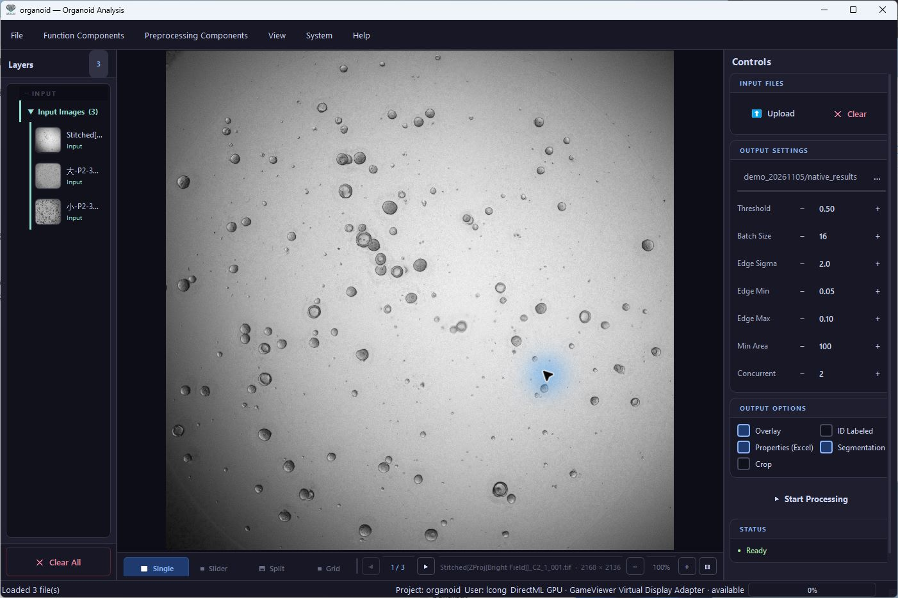

## 下载与启动

本仓库用于软件发布、文档及反馈，不包含应用源代码。请在仓库的 **Releases** 页面下载用户版附件；若尚无公开版本，说明下载尚未开放。GitHub 自动生成的 Source code ZIP 仅包含本仓库文档，不是软件运行包。

相关说明：[使用与账号](TERMS_OF_USE.md) · [问题反馈](SUPPORT.md) · [更新记录](CHANGELOG.md) · [第三方组件](THIRD_PARTY_NOTICES.md)。

软件运行包和使用文档应作为两个独立附件提供，用户不需要下载完整开发目录。

| 附件 | 用途 |
| --- | --- |
| `OrganoidAnalysis-2.21-Windows-x64.zip` | Windows 软件运行包 |
| `OrganoidAnalysis-2.21-UserGuide-zh-CN.zip` | 中文使用文档 |
| `OrganoidAnalysis-2.21-SampleData.zip` | 获准公开后提供的 3 张 TIFF 示例 |
| `SHA256SUMS.txt` | 下载文件校验值 |

图文指南 ZIP 包含 README.md 及配套截图，请完整解压并使用支持 Markdown 图片的阅读器查看。下载入口以项目实际发布的附件为准，本文未添加尚未创建的下载链接。

1. 完整解压运行包到可写目录，不要在 ZIP 内运行或只复制 EXE。
2. 打开 `OrganoidAnalysis.exe`，保留随包的模型和依赖文件。
3. 按提示完成账户登录及项目选择。本次演示由用户本人完成登录。
4. 导入图片，设置输出目录，开始分析。

本次环境为 Windows；其他系统未验证。免费分发软件不等于已采用开源代码许可证，使用与再分发条件以发布者随包声明为准。

## 功能导航

| 模块 | 功能 | 本页展示 |
| --- | --- | --- |
| [界面区域导览](#界面功能区域介绍) | 主界面、Charts、Clustering 的区域与控件 | 按位置对照截图 |
| [输入与分割](#1-导入图像与批量分割) | 多图导入、参数设置、批处理 | 3 张图完整运行 |
| [结果查看](#2-查看结果与输出文件) | 轮廓、编号、Excel、图层操作 | 结果及右键菜单 |
| [个体统计](#3-个体指标分布图) | Merged Distribution 合并分布 | 单图或多图对象合并、手动 X 范围 |
| [图片级统计](#4-图片级统计对比) | 多指标柱状图与折线比较 | 2 类图表 |
| [聚类](#5-单图与多图联合聚类) | 单图/联合形态聚类、图像特征聚类 | 3 种场景 |
| [人工整理与导出](#6-手动调整与聚类导出) | 移动对象、分类别统计导出 | 实际操作成功 |
| [预处理](#7-比例尺与区域分析) | 比例尺标定、区域框选、恢复全图 | 入口与框选演示 |

入口展示不代表端到端测试通过；未验证功能在文末及演示记录中明确列出。

## 界面功能区域介绍

### 主界面：导入、预览和分割控制

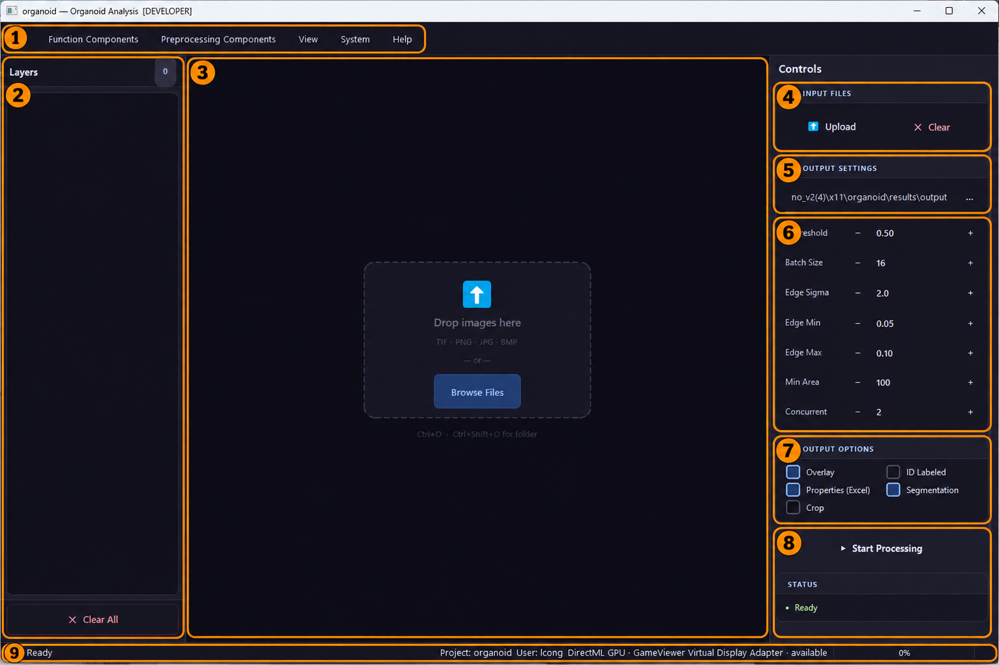

上图基于 2026-11-10 当前打开的开发者版空白主界面制作。[查看未标注原图](docs/images/18-current-main-raw.png)。**以下编号与图中橙色编号一一对应**：

| 图中编号 | 区域名称 | 使用说明 |
| --- | --- | --- |
| **1** | 顶部菜单 | 进入文件操作、分析组件和预处理功能；比例尺和区域分析在 Preprocessing Components 中 |
| **2** | 左侧图层列表 | 导入后显示缩略图与文件名，点击切换图片；底部 Clear All 为清理列表入口 |
| **3** | 中央预览区域 | 空白时可拖入图片或点击 Browse Files；载入后用于查看原图、结果和框选区域 |
| **4** | 输入控制 | Upload 添加图片；导入后先到 2 区核对文件名和数量 |
| **5** | 结果保存路径 | 点击路径旁的省略号选择输出目录；处理完成后核对实际目录是否带新增后缀 |
| **6** | 分割参数 | 设置阈值、批大小、边缘参数、最小面积和并行数量 |
| **7** | 输出内容 | 按需求勾选 Overlay、ID Labeled、Excel、Segmentation 和 Crop |
| **8** | 启动与状态 | 点击 Start Processing；结合 Status、完成提示及输出文件确认处理结果 |
| **9** | 底部状态栏 | 查看提示、项目与运行环境；这是软件状态，不是类器官测量结果 |

建议操作顺序：**4 导入 → 2 核对 → 5 选目录 → 6 调参数 → 7 选输出 → 8 运行 → 3 看结果**。

对照本文开头的主界面截图，可按“左侧选图 → 中央看图 → 右侧设置 → 下方看状态”的顺序使用。

| 所在位置 | 区域 / 控件 | 功能与操作 |
| --- | --- | --- |
| 顶部 | 菜单栏 | File 提供文件操作入口；Function Components 进入分析功能；Preprocessing Components 提供比例尺标定、区域分析及恢复全图；另有 View、System、Help 菜单。系统与账户管理未纳入本次测试 |
| 左侧 | Layers / Input Images | 显示已导入图片的缩略图和名称；点击切换当前预览。图层数量不等于生物学样本数，重新导入结果图也会增加图层 |
| 左下方 | Clear All | 清空当前列表的操作入口；不应把清空界面理解为删除磁盘上的原始文件 |
| 中央 | 图像预览区 | 查看当前原图或结果图，检查对象轮廓、编号与局部细节；区域框选及比例尺框选也在这里完成 |
| 右上方 | Upload / Clear | 添加图片、清理当前输入的操作入口。导入完成后先核对左侧文件数量与名称 |
| 右侧上部 | Output Settings | 选择结果保存目录；该路径与图片导入目录用途不同 |
| 右侧中部 | 参数设置 | Threshold、Batch Size、Edge Sigma、Edge Min、Edge Max、Min Area、Concurrent 控制分割与处理设置，示例值见下一节 |
| 右侧下部 | Output Options | 勾选要输出的轮廓图、编号图、Excel、分割结果及裁剪内容。它们是输出选择，不是聚类方法选择 |
| 右侧下部 | Start Processing / Status | 启动处理并查看状态提示；是否完成应结合完成提示和实际结果文件确认 |
| 右下方 | Open Results Folder | 打开结果文件夹的入口。遇到目录自动追加后缀时，以实际含结果文件的目录为准 |
| 预览区底部左侧 | Single / Slider / Split / Grid | 分别为单图、滑动对比、左右分屏和缩略图网格的设计入口；本次仅单图显示得到确认，其他视图不作为已通过测试宣传 |
| 预览区底部中间 | 图片序号、前后切换与文件信息 | 定位当前图片，查看文件名及尺寸等信息，避免把不同图片的结果混淆 |
| 预览区底部右侧 | 缩放与适应窗口 | 放大、缩小或使图像适应预览区域；改变显示比例不等于改变原始图像的物理标定 |
| 整个窗口底边 | 状态栏 | 显示操作提示，以及当前项目、用户和运行环境信息；对外分享截图前检查是否含不宜公开的信息 |

### Charts 页面：左侧配置，右侧读图

本页以 [Merged Distribution 合并分布截图](docs/images/05-pooled-distribution.png) 介绍 Charts，完整图示见第 3 节。操作顺序：**选数据源 → 选图片 → 选 Merged Distribution → 选指标及范围 → 绘图 → 检查 → 导出**。

| 区域 | 界面文字 | 用途 |
| --- | --- | --- |
| 顶部页签 | Charts / Organoid Clustering | 在统计绘图与对象聚类之间切换 |
| 左上 | Data Source / Browse… | 选择个体明细或图片汇总工作簿；加载提示中的行列数用于检查是否读到了数据 |
| 左侧 | Images (multi-select) | 选择参与当前图表的图片，不必把已加载图片全部画出 |
| 左侧中部 | Chart Type | 个体指标选择 Merged Distribution；图片级汇总的柱状/折线图另见第 4 节 |
| 左侧中下部 | Columns / Metric | 指定指标。个体分布建议一次选一个；图片级汇总可按需多选 |
| 左侧下部 | X range | 设置分布图横轴显示的起点和终点；不是数据删除或过滤条件 |
| 左下 | Plot Chart / Export as PNG | 按当前配置绘图，以及保存图表的入口；修改配置后应重新绘图 |
| 右侧主体 | 图表标题、坐标轴、图例 | 标题确认指标及图表类型，坐标轴确认数值含义，图例对应不同图片或指标 |
| 图表底部 | 图形工具栏 | 提供图形视图调整和保存等工具入口，本次未逐项验证 |

### Organoid Clustering 页面：设置、对象卡片与人工整理

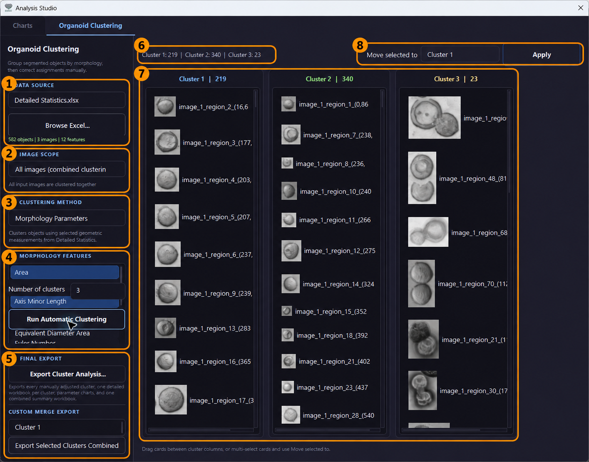

| 图中编号 | 区域名称 | 使用说明 |
| --- | --- | --- |
| **1** | 个体数据 | 加载 Detailed Statistics.xlsx，下方检查对象、图片和特征数量 |
| **2** | 图片范围 | 选择单张图片，或 All images 进行联合聚类 |
| **3** | 聚类方法 | 选择形态参数或 EfficientNetB3 图像特征 |
| **4** | 特征、类别数与运行 | 按方法配置特征及 K 值，点击 Run Automatic Clustering |
| **5** | 结果导出 | Final Export 导出当前分组；下方为指定类别组合导出入口 |
| **6** | 分组数量摘要 | 查看每类对象数；本次原始形态聚类为 219、340、23 |
| **7** | 对象卡片列 | 每列是一类，每张卡片是一个分割对象；用于检查外观和选中对象 |
| **8** | 人工移动 | 在 7 区选对象，在此选择目标类别并 Apply；随后检查 6 区计数 |

建议操作顺序：**1 → 2 → 3 → 4 运行 → 6/7 检查 → 8 必要时调整 → 5 导出**。本图为上次实测界面的区域导览，不作为显微图像分析证据。

对照 [联合聚类截图](docs/images/09-joint-clustering.png)：

| 区域 | 界面文字 | 用途 |
| --- | --- | --- |
| 左上 | Data Source / Browse Excel… | 加载个体明细；下方提示对象数、图片数及可用特征数 |
| 左侧 | Image Scope | 选单张图片，或 All images 进行多图对象联合聚类 |
| 左侧 | Clustering Method | 在形态参数与 EfficientNetB3 图像特征方法之间选择 |
| 左侧中部 | Morphology Features / Number of clusters | 选择形态特征并设置类别数 K；图像特征方法不等于使用同一组手选形态参数 |
| 左侧中下部 | Run Automatic Clustering | 执行当前范围和方法下的自动聚类；改变设置后需要重新运行 |
| 中央顶部 | 类别数量摘要 | 显示各类别的对象数；联合示例为 219、340、23，总计 582 |
| 中央主体 | Cluster 1 / 2 / 3 对象列 | 每列展示该类的对象缩略图和标识，用于检查外观及查找个体；列标题数量是对象数，不是图片数 |
| 右上 | Move selected to / Apply | 将选中对象移至目标类别，调整后复核数量摘要 |
| 左下 | Final Export | 导出当前各类别的明细、参数图及汇总 |
| 左下 | Custom Merge Export | 指定类别组合导出的入口；本次未完成该路径验证 |

## 1. 导入图像与批量分割

点击 **Upload** 添加图片，或按 **Ctrl + Shift + O** 选择图片文件夹。左侧 Layers 显示输入列表，中间预览图像，右侧 Controls 设置分析参数。

本次使用 `Sample_Data` 中的 3 张原始图片：

| 图片 | 分割后对象数 |
| --- | ---: |
| `Stitched[ZProj[Bright Field]]_C2_1_001.tif` | 126 |
| `大-P2-3D-7d-4X.tif` | 241 |
| `小-P2-3D-14d-4X-1.tif` | 215 |
| 合计 | **582** |

选择输出目录，检查参数后点击 **Start Processing**。

| 参数 | 本次值 | 提示 |
| --- | ---: | --- |
| Threshold | 0.50 | 分割阈值；调整后复查漏检和边界 |
| Batch Size | 16 | 批处理规模 |
| Edge Sigma | 2.0 | 边缘处理参数 |
| Edge Min / Edge Max | 0.05 / 0.10 | 边缘检测相关阈值 |
| Min Area | 100 | 最小对象面积筛选参数 |
| Concurrent | 2 | 并行处理设置 |

输出选项包括 **Overlay、ID Labeled、Properties (Excel)、Segmentation、Crop**。按需选择；后续图像特征聚类需要保留对象图像和统计结果的完整目录关系。

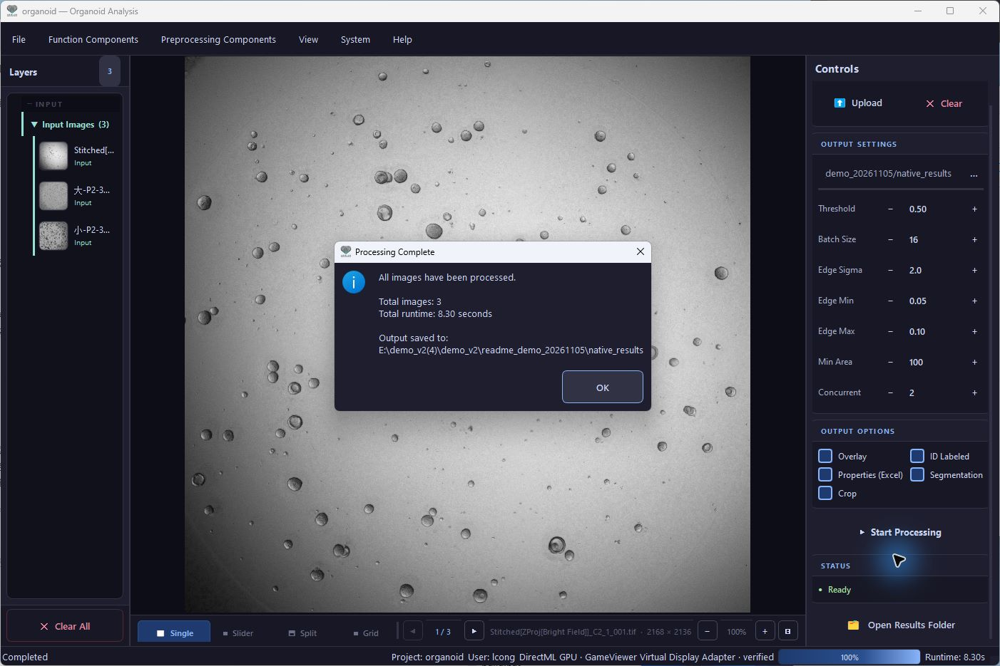

**8.30 秒**仅代表本次本机运行，不是其他设备或数据集的速度承诺。

## 2. 查看结果与输出文件

### 左侧输出结果树：按来源和结果类型查找

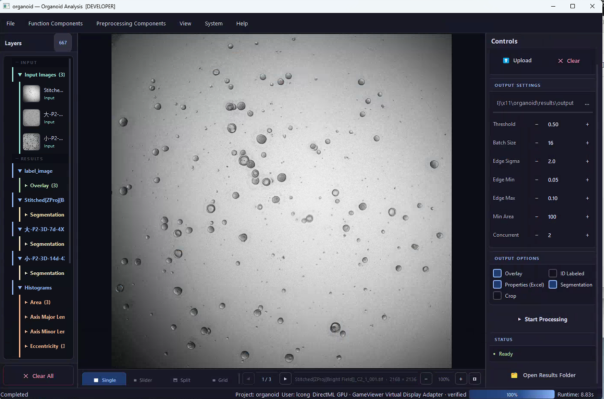

本图由用户于 2026-11-11 提供，与前面的演示属于不同运行状态，不沿用前次 582 个对象的统计结论。左侧 Layers 是**结果文件的分类导航树**，不是单一文件夹，也不是聚类类别列表。按截图从上到下阅读：

| 界面位置 / 名称 | 含义 | 展开后查看什么 |
| --- | --- | --- |
| 顶部 `Layers 667` | 当前面板登记的图层条目总数，包括输入、结果图、统计图及表格等 | **不是检测到 667 个类器官**；对象数应查统计 Excel |
| `INPUT → Input Images (3)` | 本次导入的 3 张原始图片 | 点击缩略图查看原图，作为结果复核的参照 |
| `RESULTS` | 软件输出结果的总分区标题 | 下方按结果类型及原图来源组织，不代表新增输入 |
| `label_image → Overlay (3)` | `label_image` 目录中的 3 个图像结果条目，界面统一归入 Overlay | 展开后点击具体文件，检查整张图上的分割叠加效果；若启用编号输出，需结合实际文件名区分编号图，不能假定 Overlay 分组内永远只有轮廓图 |
| `Stitched… → Segmentation` | 第一张原图对应的分割对象图像 | 展开后通常是 `region_1`、`region_2` 等个体图，用于检查单个对象 |
| `大-P2-3D-7d-4X → Segmentation` | 第二张原图的分割对象图像 | 与第一张图分开保存，避免混淆个体来源 |
| `小-P2-3D-14d-4X… → Segmentation` | 第三张原图的分割对象图像 | 同名 region 编号可能出现在不同原图中，定位时要同时记录原图名称 |
| `Histograms` | 自动生成的指标分布图分组 | 按指标分类，而不是按聚类类别分类 |
| `Area (3)` | 面积指标下有 3 个图表文件条目 | 展开后按具体文件名区分来源图片；括号中的 3 不是面积值，也不是 3 个对象 |
| `Axis Major Length` / `Axis Minor Length` | 长轴长度 / 短轴长度分布图 | 用于观察尺寸分布；物理单位须结合实际标定确认 |
| `Eccentricity` | 偏心率分布图 | 描述形状的伸长程度，不是面积或对象数量 |

**展开方法：**点击条目前的小三角。`▶` 表示折叠，`▼` 表示展开；点击展开后的具体文件条目查看对应结果。名称显示不全或下方内容未出现时，可滚动列表，必要时到实际输出目录核对完整文件名。

**括号数字的统一含义：**表示该分组内登记的文件/图层条目数。只有当 Segmentation 中每个条目恰好对应一个有效对象时，它的条目数才可与对象数对应，仍建议用统计表核对。

左侧与磁盘文件的对应关系为：

```text
左侧结果树                               磁盘输出目录
label_image / Overlay                 → label_image/ 下的图像文件
某张原图 / Segmentation               → Analysis_result/seg/该图目录/ 下的 PNG
Histograms / 某指标                   → Analysis_result/Histograms/该指标/ 下的 PNG
```

简单区分：**Overlay 看整图分割位置；Segmentation 看单个对象；Histograms 看指标分布；Excel 看可计算、可汇总的数值。**左侧 Histograms 是已生成的结果文件，Charts 则用于重新选择图片、指标和坐标范围制作图表。

### 界面结果应该怎么看

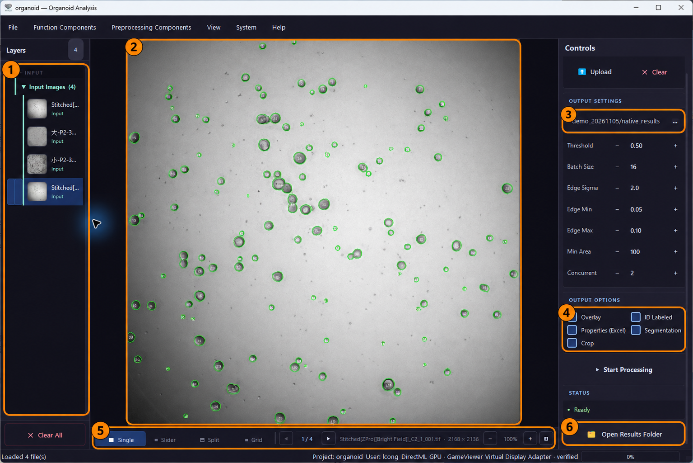

| 图中编号 | 结果区域 | 如何读取与使用 |
| --- | --- | --- |
| **1** | 当前图层 | 先确认选中哪张图。本例第 4 个图层是重新导入的 overlay，不是第 4 张原始样本 |
| **2** | 分割结果预览 | 绿色轮廓表示检测对象边界，编号帮助定位；复核漏检、粘连和碎片请使用未标注原图 |
| **3** | 输出目录设置 | 显示所选路径；实际目录可能追加 `_1` 等后缀，不能只按提示路径判断 |
| **4** | 输出选择 | 决定本次要保存哪些内容；勾选本身不等于文件已生成 |
| **5** | 图像浏览控制 | 查看图片序号、文件信息及显示比例；视图操作不改变 Excel 测量数据 |
| **6** | 打开结果目录 | 到磁盘检查 overlay、编号图、两种 Excel 及对象数据；界面截图不能代替结果文件 |

本导览基于上次实测结果页面制作。[查看未标注结果原图](docs/images/03-segmentation-overlay.png)。**读图顺序：1 确认图片 → 2 看结果 → 3/6 找文件**。

“界面正在显示的内容”和“已经保存到磁盘的文件”是两件事。建议先确认处理完成，再检查结果图，最后核对工作簿和导出目录。

| 结果界面 | 显示内容 | 建议核对什么 | 对应保存内容 |
| --- | --- | --- | --- |
| 分析完成提示 | 处理图片数量、耗时、输出路径 | 数量是否与本次输入一致；路径是否被自动追加后缀 | 实际输出目录，而非提示文字本身 |
| 中央结果预览 | 图像上的轮廓、编号或当前所选图层 | 有无漏检、粘连、碎片和异常边界；当前是哪张图 | `label_image` 下的 overlay / id-labeled TIFF |
| Charts 个体分布 | 各对象某项指标的分布或按图分组结果 | 指标、参与图片、横轴范围与纵轴含义 | 原始数据来自 `Detailed Statistics.xlsx`；图表保存需另行导出 |
| Charts 图片级比较 | 每张图片的对象数、面积或平均尺寸等汇总指标 | 多选指标的量纲是否相同；图片顺序是否有实验意义 | 原始数据来自 `Output Statistical value.xlsx`；图表保存需另行导出 |
| 聚类结果 | 各类别对象卡片与类别计数 | 选择的是单图还是联合范围；类别数及对象总数是否正确 | 点击聚类导出后生成类别明细、图表与汇总表 |
| 人工调整后的聚类 | 对象归属及类别数量更新 | 移动数量是否符合预期；是否记录调整原因 | 应重新导出当前分组，不能认为旧导出文件会自动同步 |
| 导出完成提示 | 保存位置和导出成功信息 | 目录中是否确实存在文件，文件能否打开 | 按本次指定目录检查，而不是只保留提示截图 |

### 输出选项与使用目的

| 输出选项 | 用户用途 | 检查要点 |
| --- | --- | --- |
| Overlay | 查看原图与分割轮廓的叠加效果 | 用于快速复核分割位置，不等于分割准确率报告 |
| ID Labeled | 通过编号定位对象 | 对象标识应结合原始图片一起记录，避免跨图片混淆 |
| Properties (Excel) | 后续统计绘图与形态分析 | 保留明细表和图片汇总表，两者统计层级不同 |
| Segmentation | 保存分割相关结果，供后续检查与分析 | 实际文件形式以当前运行包输出为准 |
| Crop | 输出裁剪相关内容，便于查看个体 | 与分割及对象图像输出可能有关联，不假定一定有独立的 `Crop` 文件夹 |

本次能确认的文件结构见下文；并非每个勾选项都会对应一个同名目录。

### 轮廓叠加与对象编号

绿色轮廓用于检查分割位置，编号用于定位个体。建议先复核粘连、碎片、边缘对象及异常光照区域，再解释统计结果。

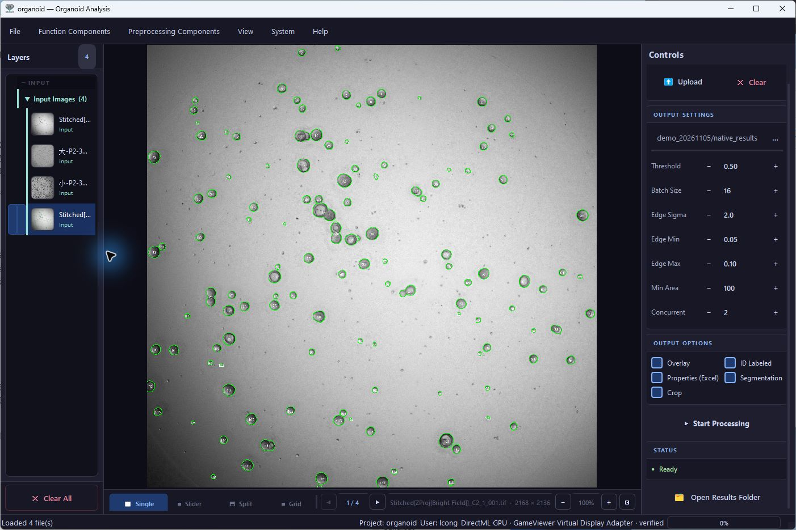

截图中的第 4 个图层是重新导入的 overlay 结果，用于显示效果，**不是第 4 张原始样本**。582 个对象来自最初 3 张图。

### 结果目录

```text
输出目录/
├─ Analysis_result/
│  ├─ Detailed Statistics.xlsx
│  ├─ Output Statistical value.xlsx
│  ├─ Histograms/
│  └─ seg/
└─ label_image/
   ├─ *_overlay.tif
   └─ *_id-labeled.tif
```

- **Detailed Statistics.xlsx**：个体指标；原工作簿按指标分工作表、按图片分列，软件会整理为对象级数据。
- **Output Statistical value.xlsx**：每张图片的对象数、总面积、平均长轴、平均短轴、平均等效直径。
- **seg/**：分割对象数据，供对象查看及后续图像特征分析使用。
- **label_image/**：轮廓叠加图和编号图。

不要只移动 Excel 而丢失配套对象图像。

### 两种 Excel 的区别与结果追溯

| 工作簿 | 数据组织 | 适合回答的问题 |
| --- | --- | --- |
| `Detailed Statistics.xlsx` | 按指标分工作表、按图片分列，不同图片对象数不同，因此列尾可能有空值 | 某张图内对象的面积分布如何？多张图的个体尺寸分布是否不同？哪些对象形态相似？ |
| `Output Statistical value.xlsx` | 每张图片一行，包含对象数、总面积及部分平均尺寸 | 哪张图检测对象更多？各图片平均长轴、平均短轴如何比较？ |

本次汇总表中的对象数分别为 126、241、215，与明细中对应图片的有效对象数相符。不同图片列尾的空值不应当作面积为 0 的对象。

聚类导出会生成另一套按类别组织的同名工作簿，**同名不代表同一层级**：原始分析汇总按图片组织，聚类分析汇总按类别组织。共享或归档时请保留父目录，并注明聚类方法、图片范围、K 值及是否经过人工调整。

### 图层右键操作

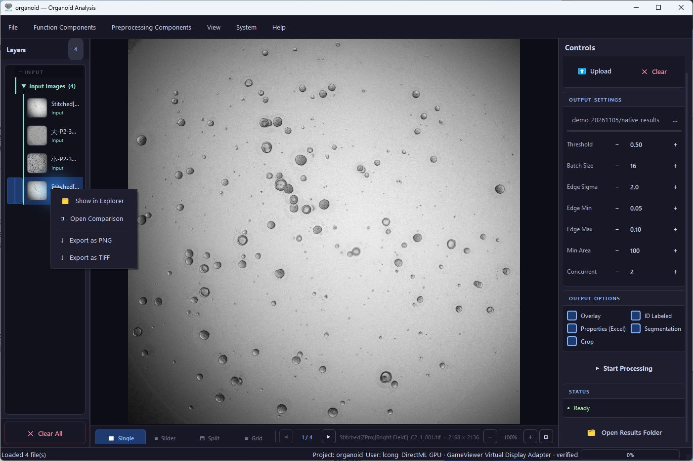

右键提供 **Show in Explorer、Open Comparison、Export as PNG、Export as TIFF**。本次展示了入口，未完成图层导出与完整配对对比的全流程验证。底部另有 Single、Slider、Split、Grid 视图入口，相关限制见文末。

## 3. 个体指标分布图

打开 **Analysis Studio**（**Ctrl + Shift + C**），进入 **Charts**，选择 `Detailed Statistics.xlsx`。

操作顺序：**选择数据源 → 选择图片 → 选择一个指标 → 选择图表类型 → Plot**。可以选一张、几张或全部图片；为避免歧义，建议每次只选一个个体指标。

本次指标包括 Area、长/短轴、等效直径、偏心率、周长、Solidity、Extent 等。Centroid 为坐标数据，不是普通一维标量指标。

### Merged Distribution（合并分布）

选择 **Merged Distribution**，将所选图片中的对象汇总到一个分布。

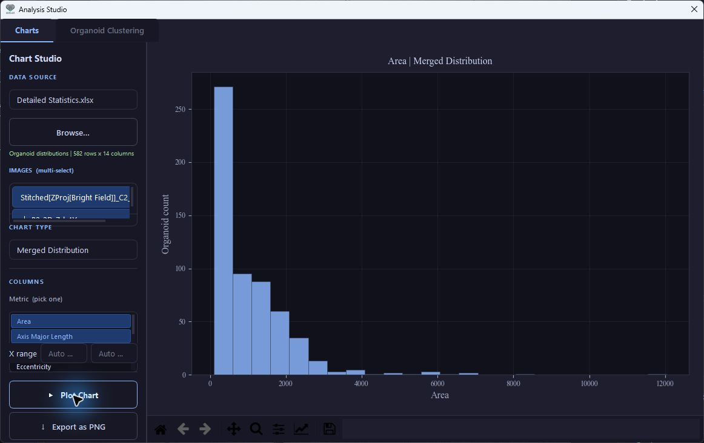

合并是按对象汇总，对象较多的图片贡献更多数据，并非每张图片等权。适合观察总体分布，但不能替代图片间比较。

只选择一张图片时，显示该图内部对象的指标分布；选择多张图片时，将所选图片的对象合并为一组。横轴为所选指标值，纵轴为对象计数，不是自动归一化的概率密度。

### 手动统一横坐标范围

在 **X range** 填入最小值与最大值，例如 Area 使用 **0** 和 **5000**，然后点击 Plot。分别生成多个合并分布图时，可使用相同范围统一显示尺度；上图展示的是原始合并分布示例，并非应用此范围后的新截图。

该设置仅控制坐标显示范围，**不删除范围外对象，也不筛选原始数据**。统一横坐标不等于统一直方图分箱边界，严格比较时还需检查分箱规则。

窗口提供 **Export as PNG**；本次验证了绘图，未单独验证该按钮保存文件的流程。

## 4. 图片级统计对比

切换数据源到 `Output Statistical value.xlsx`，选择图片和汇总指标。

上一模块比较每个对象的测量值，本模块比较每张图片的一行汇总值。可同时选择多个指标，但不同量纲或数量级不宜直接混画。

### 4.1 分组柱状图

选择 **Grouped Bar Comparison**。示例同时比较 **Average Major Axis Length** 与 **Average Minor Axis Length**。

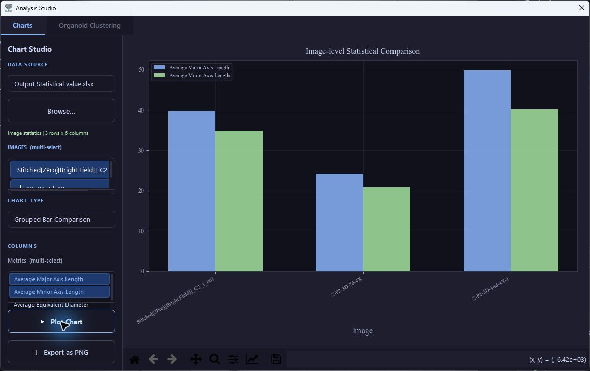

### 4.2 折线对比

选择 **Line Comparison**，展示所选指标在图片之间的变化。

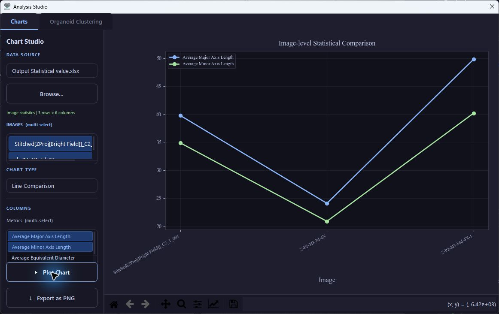

若图片不是按时间或剂量采集的有序样本，连线只是视觉比较，不代表时间趋势。本模块将多张图片放在同一图中比较；不要把每图平均值的简单平均当成所有对象合并后的平均值。

## 5. 单图与多图联合聚类

进入 **Organoid Clustering**。聚类对象是分割出来的个体类器官，不是把整张显微图片归类。

### 5.1 单张图片内部的形态聚类

选择 **Morphology Parameters**，在图片范围中选一张图，选择形态特征和类别数，点击 **Run Automatic**。

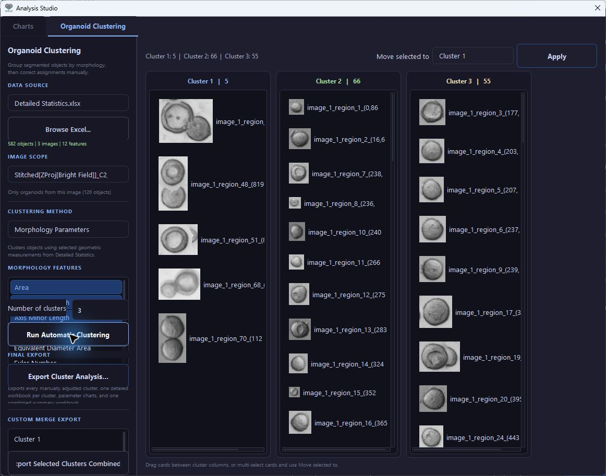

本次第一张图的 126 个对象，K = 3，得到 **5、66、55** 个对象，用于展示同一图片内部的分组。

### 5.2 多张图片联合形态聚类

图片范围选择 **All images (combined clustering)**，设置特征与类别数后重新运行。

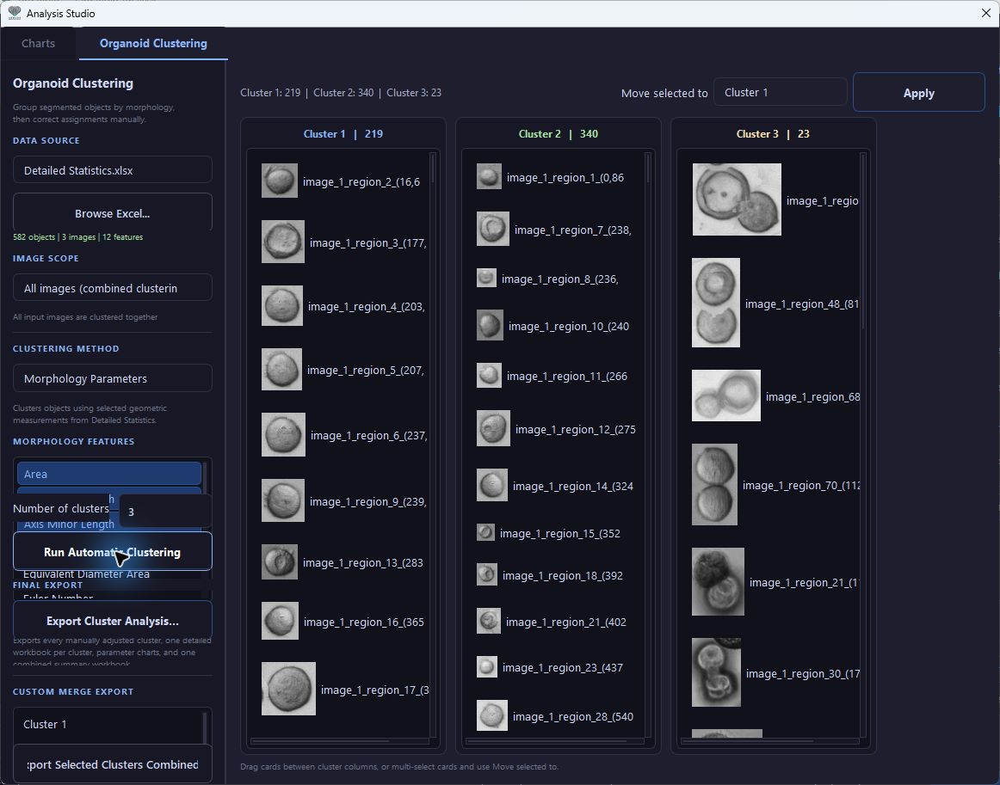

本次 582 个对象联合聚为 3 类，数量为 **219、340、23**。联合聚类在一次运行中建立共享分组；分别运行的单图 Cluster 1 不保证具有相同含义。

### 5.3 图像特征聚类

方法选择 **EfficientNetB3 Image Features**，使用对象图像提取特征后聚类。

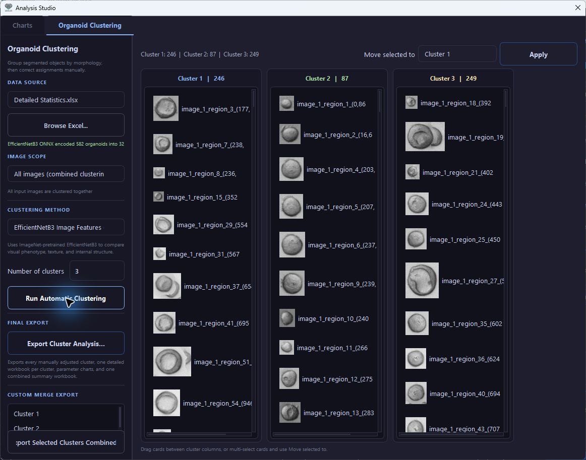

本次 K = 3，得到 **246、87、249** 个对象。图像特征与形态参数包含的信息不同，因此分组可能不同。类别编号没有预设生物学含义，不等于已识别某种细胞类型或成熟阶段。

## 6. 手动调整与聚类导出

### 6.1 人工调整对象归属

选择对象卡片，通过 **Move selected to** 选择目标类别，点击 **Apply**。调整前建议保存原始分组，并记录调整理由。

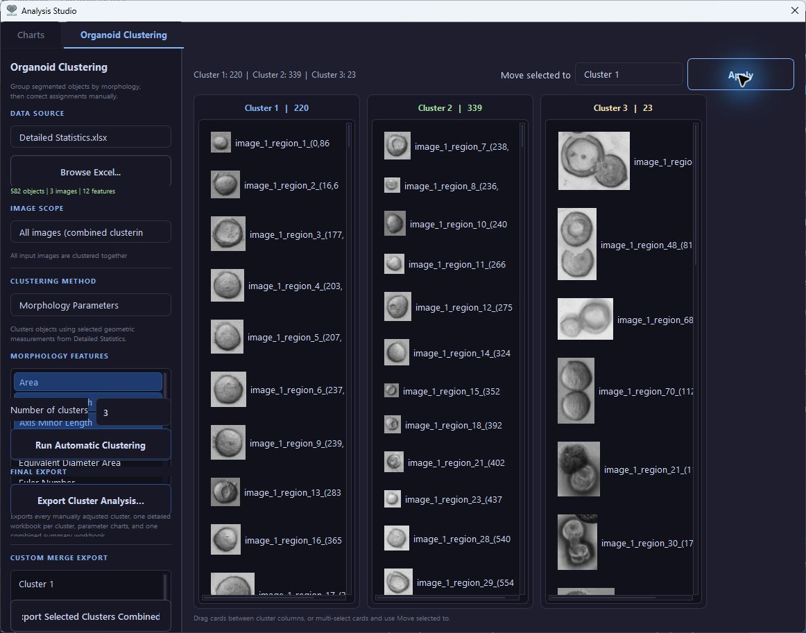

本次仅为操作演示移动了一个对象，类别数量由 219/340/23 变为 **220/339/23**，不代表经过生物学审核的标签修正。

### 6.2 导出类别明细、参数图与汇总

点击 **Export Cluster Analysis…** 并选择目录，导出当前调整后的类别分析。

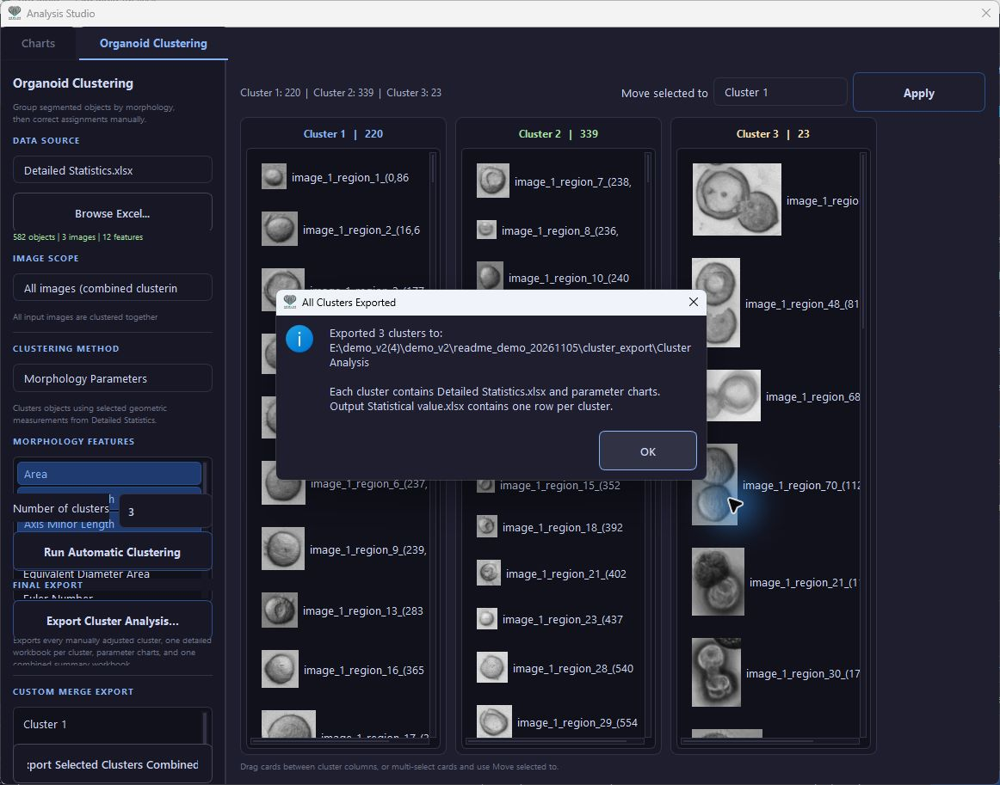

```text
Cluster Analysis/
├─ Output Statistical value.xlsx
├─ Cluster_1/
│  ├─ Detailed Statistics.xlsx
│  └─ Histograms/
├─ Cluster_2/
│  ├─ Detailed Statistics.xlsx
│  └─ Histograms/
└─ Cluster_3/
   ├─ Detailed Statistics.xlsx
   └─ Histograms/
```

界面另有 **Export Selected Clusters Combined…**，用于指定类别的组合导出，本次未单独执行。已实测导出的文件来自人工调整后的形态聚类，不是之后重新运行的图像特征聚类。

## 7. 比例尺与区域分析

### 7.1 比例尺标定

菜单 **Preprocessing Components → Scale Calibration (µm/pix)…**，快捷键 **Ctrl + Shift + M**。进入后按提示框住比例尺。

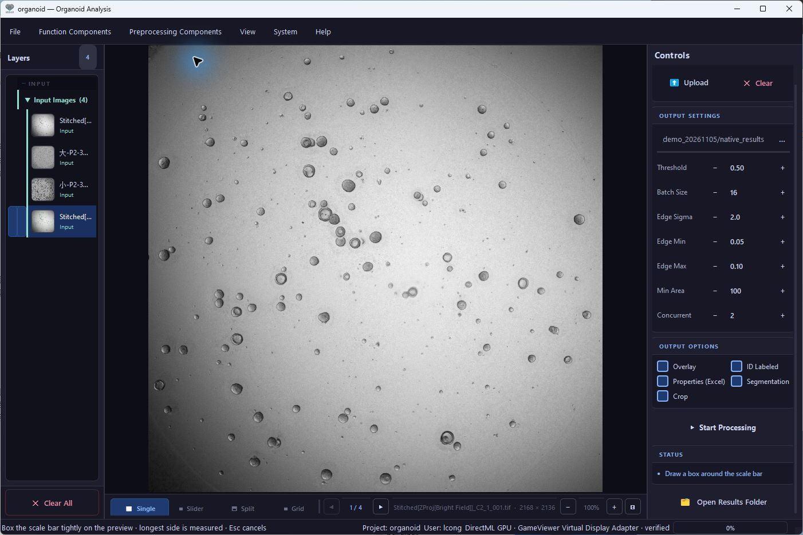

本次没有可靠的实际比例尺数值，因此只展示入口并取消，未填写假定尺寸。应依据显微镜标定或已知比例尺设置；未确认标定前，不要把像素长度和面积直接写成 µm 和 µm²。

### 7.2 指定分析区域

菜单 **Preprocessing Components → Screenshot / Region Analysis…**，快捷键 **Ctrl + Shift + P**，在预览图上拖出矩形。

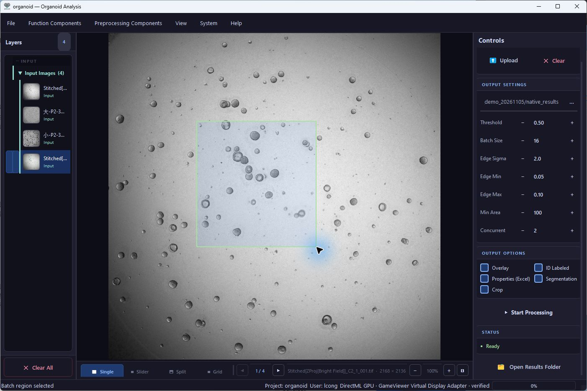

本次实际完成框选，未用该区域重新运行分割；随后使用 **Clear Analysis Region · Use Full Images** 恢复全图。批量处理不同尺寸图片时，应先核对区域映射。

## 常见问题与使用边界

**找不到结果？** 本次所选输出目录已存在，程序实际写入追加 `_1` 的目录，但完成提示仍显示原目录。请找到包含两个 Excel 的 `Analysis_result`，必要时在 Charts 中手动指定。

**图表中文显示方框？** 当前运行包部分图表标签缺少中文字体，数据仍可读取。可以使用英文样本编号并保留名称对照表，或由维护者修复字体后重新出图。

**聚类控件拥挤？** 本次窗口尺寸下存在局部布局拥挤；发布前建议检查不同分辨率与显示缩放。

**对比/网格视图未切换？** 本次未成功验证 Slider/Grid 切换及完整原图—结果配对，不作为已通过功能宣传。可先使用单图和导出结果复核。

**能直接用于统计结论吗？** 聚类是探索性分组，需结合人工复核。582 个对象不自动等于 582 个独立生物学重复；推断时应考虑培养孔、图片与实验批次层级。

**适用于所有图像吗？** 本次只验证随软件提供的 3 张图，其他成像条件、倍率和样本需重新评估。软件输出不应直接替代临床判断。

## 反馈与平台信息

反馈时请提供版本、步骤、报错截图及可公开的最小示例，先移除隐私和账户信息。正式下载链接、平台官网、联系方式与许可证声明应由发布者确认后添加，本文未虚构这些信息。

演示日期：2026-11-05。详见 [演示记录与待验证项](docs/DEMO_RUN.md)。

文档更新：2026-11-10，补充主界面、Charts、聚类页面的功能区域，以及界面结果与输出文件的对应说明；本次更新未新增软件运行测试。
