# Organoid Analysis｜类器官图像分析平台

从显微图像到个体分割、形态统计、图表比较与聚类分析的一体化桌面工具。

本页面向 Windows 软件用户。**17 张截图均来自 2.21 运行包的实际操作**，使用随项目提供的示例图，不是概念图。验证范围见 [演示记录](docs/DEMO_RUN.md)。

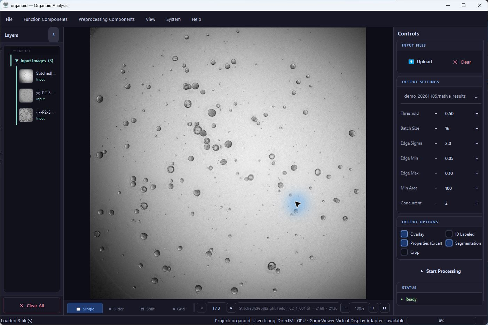

## 下载与启动

软件运行包和使用文档应作为两个独立附件提供，用户不需要下载完整开发目录。

| 附件 | 用途 |
| --- | --- |
| `OrganoidAnalysis-2.21-Windows-x64.zip` | Windows 软件运行包 |
| `OrganoidAnalysis-2.21-UserGuide-zh-CN.zip` | 中文使用文档 |
| `SHA256SUMS.txt` | 下载文件校验值 |

下载入口以项目实际发布的附件为准，本文未添加尚未创建的下载链接。

1. 完整解压运行包到可写目录，不要在 ZIP 内运行或只复制 EXE。
2. 打开 `OrganoidAnalysis.exe`，保留随包的模型和依赖文件。
3. 按提示完成账户登录及项目选择。本次演示由用户本人完成登录。
4. 导入图片，设置输出目录，开始分析。

本次环境为 Windows；其他系统未验证。免费分发软件不等于已采用开源代码许可证，使用与再分发条件以发布者随包声明为准。

## 功能导航

| 模块 | 功能 | 本页展示 |
| --- | --- | --- |
| [输入与分割](#1-导入图像与批量分割) | 多图导入、参数设置、批处理 | 3 张图完整运行 |
| [结果查看](#2-查看结果与输出文件) | 轮廓、编号、Excel、图层操作 | 结果及右键菜单 |
| [个体统计](#3-个体指标分布图) | 合并/叠加分布、箱线/小提琴图 | 4 类图表、手动 X 范围 |
| [图片级统计](#4-图片级统计对比) | 多指标柱状图与折线比较 | 2 类图表 |
| [聚类](#5-单图与多图联合聚类) | 单图/联合形态聚类、图像特征聚类 | 3 种场景 |
| [人工整理与导出](#6-手动调整与聚类导出) | 移动对象、分类别统计导出 | 实际操作成功 |
| [预处理](#7-比例尺与区域分析) | 比例尺标定、区域框选、恢复全图 | 入口与框选演示 |

入口展示不代表端到端测试通过；未验证功能在文末及演示记录中明确列出。

## 1. 导入图像与批量分割

点击 **Upload** 添加图片，或按 **Ctrl + Shift + O** 选择图片文件夹。左侧 Layers 显示输入列表，中间预览图像，右侧 Controls 设置分析参数。

本次使用 `Sample_Data` 中的 3 张原始图片：

| 图片 | 分割后对象数 |
| --- | ---: |
| `Stitched[ZProj[Bright Field]]_C2_1_001.tif` | 126 |
| `大-P2-3D-7d-4X.tif` | 241 |
| `小-P2-3D-14d-4X-1.tif` | 215 |
| 合计 | **582** |

选择输出目录，检查参数后点击 **Start Processing**。

| 参数 | 本次值 | 提示 |
| --- | ---: | --- |
| Threshold | 0.50 | 分割阈值；调整后复查漏检和边界 |
| Batch Size | 16 | 批处理规模 |
| Edge Sigma | 2.0 | 边缘处理参数 |
| Edge Min / Edge Max | 0.05 / 0.10 | 边缘检测相关阈值 |
| Min Area | 100 | 最小对象面积筛选参数 |
| Concurrent | 2 | 并行处理设置 |

输出选项包括 **Overlay、ID Labeled、Properties (Excel)、Segmentation、Crop**。按需选择；后续图像特征聚类需要保留对象图像和统计结果的完整目录关系。

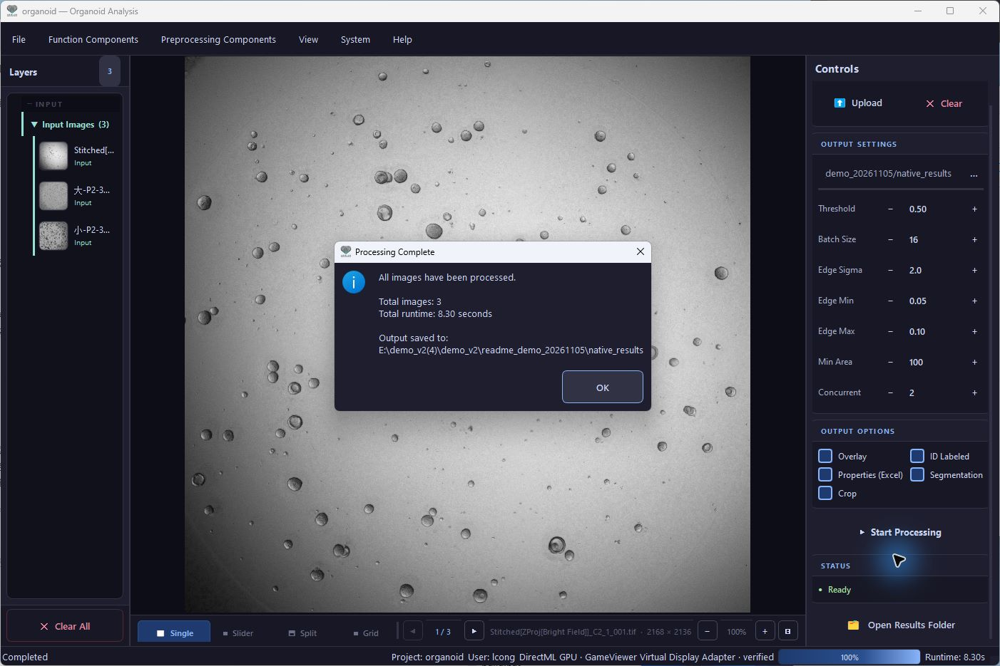

**8.30 秒**仅代表本次本机运行，不是其他设备或数据集的速度承诺。

## 2. 查看结果与输出文件

### 轮廓叠加与对象编号

绿色轮廓用于检查分割位置，编号用于定位个体。建议先复核粘连、碎片、边缘对象及异常光照区域，再解释统计结果。

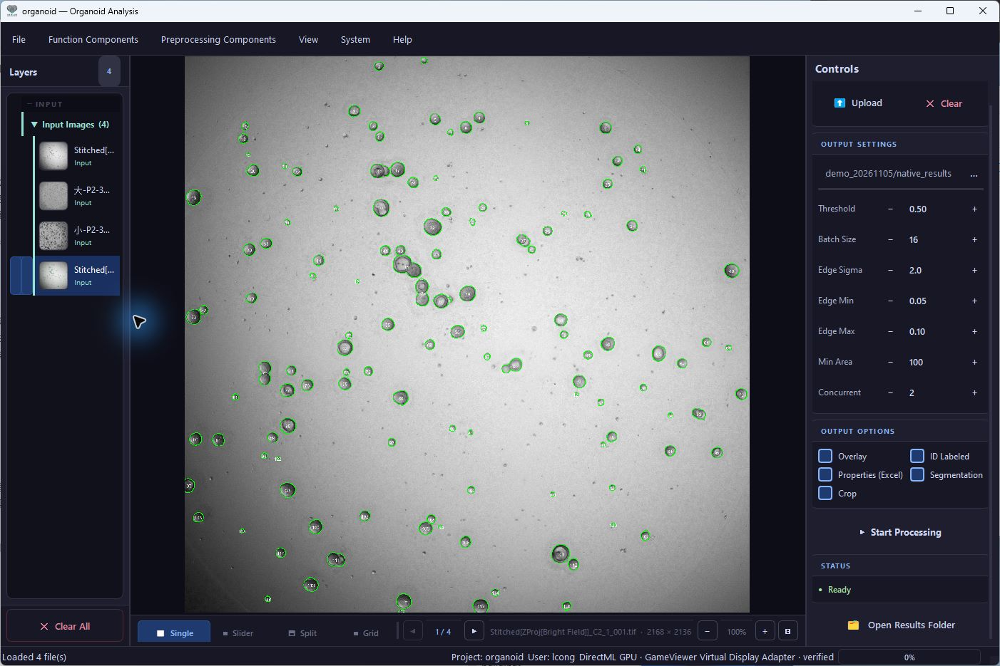

截图中的第 4 个图层是重新导入的 overlay 结果，用于显示效果，**不是第 4 张原始样本**。582 个对象来自最初 3 张图。

### 结果目录

```text
输出目录/
├─ Analysis_result/
│  ├─ Detailed Statistics.xlsx
│  ├─ Output Statistical value.xlsx
│  ├─ Histograms/
│  └─ seg/
└─ label_image/
   ├─ *_overlay.tif
   └─ *_id-labeled.tif
```

- **Detailed Statistics.xlsx**：个体指标；原工作簿按指标分工作表、按图片分列，软件会整理为对象级数据。
- **Output Statistical value.xlsx**：每张图片的对象数、总面积、平均长轴、平均短轴、平均等效直径。
- **seg/**：分割对象数据，供对象查看及后续图像特征分析使用。
- **label_image/**：轮廓叠加图和编号图。

不要只移动 Excel 而丢失配套对象图像。

### 图层右键操作

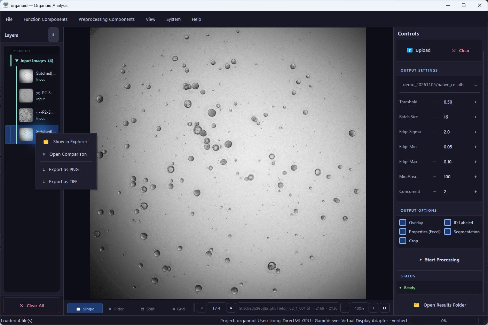

右键提供 **Show in Explorer、Open Comparison、Export as PNG、Export as TIFF**。本次展示了入口，未完成图层导出与完整配对对比的全流程验证。底部另有 Single、Slider、Split、Grid 视图入口，相关限制见文末。

## 3. 个体指标分布图

打开 **Analysis Studio**（**Ctrl + Shift + C**），进入 **Charts**，选择 `Detailed Statistics.xlsx`。

操作顺序：**选择数据源 → 选择图片 → 选择一个指标 → 选择图表类型 → Plot**。可以选一张、几张或全部图片；为避免歧义，建议每次只选一个个体指标。

本次指标包括 Area、长/短轴、等效直径、偏心率、周长、Solidity、Extent 等。Centroid 为坐标数据，不是普通一维标量指标。

### 3.1 叠加分布与手动统一横坐标

选择 **Overlaid Distribution**，每张图片以不同颜色显示同一指标的分布。

在 **X range** 填入最小值与最大值，例如 Area 使用 **0** 和 **5000**，然后点击 Plot。分别生成多个图时，为它们设置相同范围即可统一显示尺度。

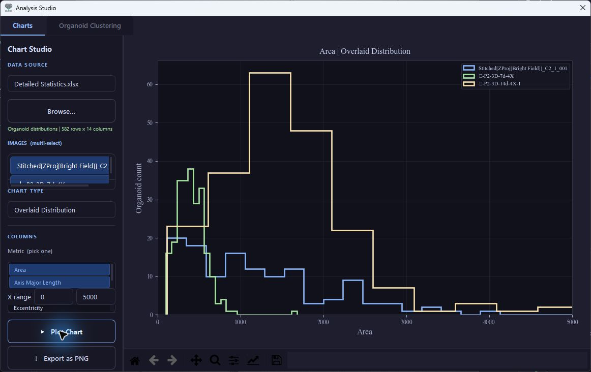

该设置仅控制坐标显示范围，**不删除范围外对象，也不筛选原始数据**。统一横坐标不等于统一直方图分箱边界；严格比较时还需检查分箱规则。纵轴是对象计数，不是自动归一化的概率密度。

### 3.2 合并分布

选择 **Merged Distribution**，将所选图片中的对象汇总到一个分布。

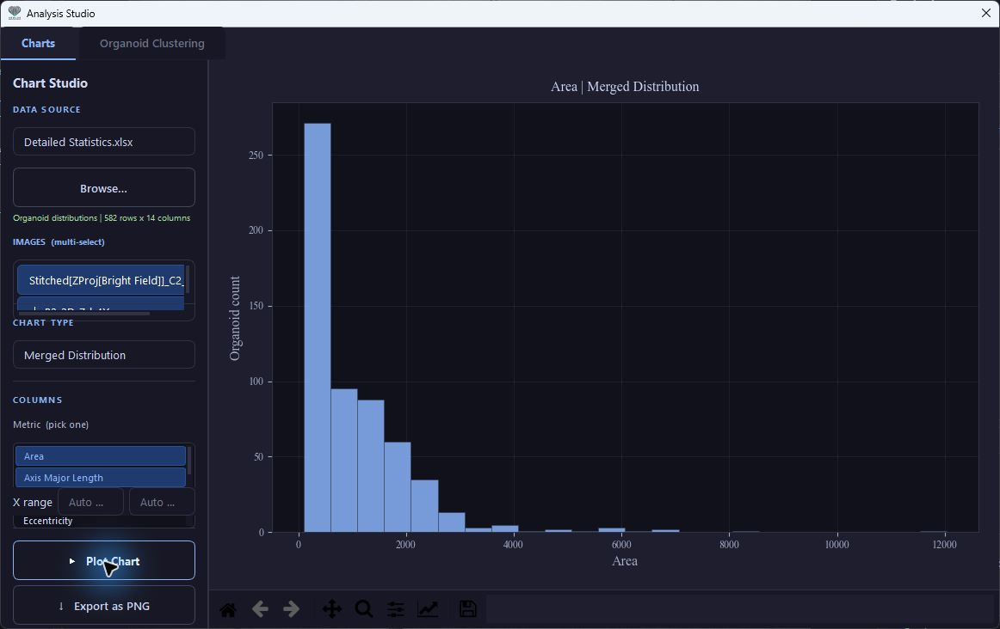

合并是按对象汇总，对象较多的图片贡献更多数据，并非每张图片等权。适合观察总体分布，但不能替代图片间比较。

### 3.3 按图片箱线图

选择 **Box Plot by Image**，比较同一指标的中位数、离散程度及离群值。

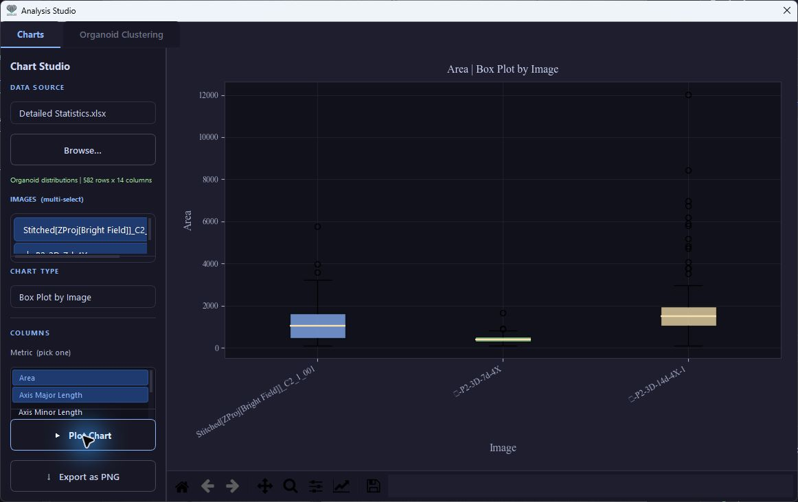

### 3.4 按图片小提琴图

选择 **Violin Plot by Image**，比较各图片的指标分布形状。

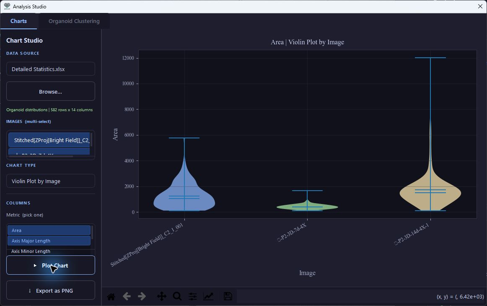

箱线图和小提琴图的横坐标是图片类别，不使用数值型 X range。窗口提供 **Export as PNG**；本次验证了绘图，未单独验证该按钮保存文件的流程。

## 4. 图片级统计对比

切换数据源到 `Output Statistical value.xlsx`，选择图片和汇总指标。

上一模块比较每个对象的测量值，本模块比较每张图片的一行汇总值。可同时选择多个指标，但不同量纲或数量级不宜直接混画。

### 4.1 分组柱状图

选择 **Grouped Bar Comparison**。示例同时比较 **Average Major Axis Length** 与 **Average Minor Axis Length**。

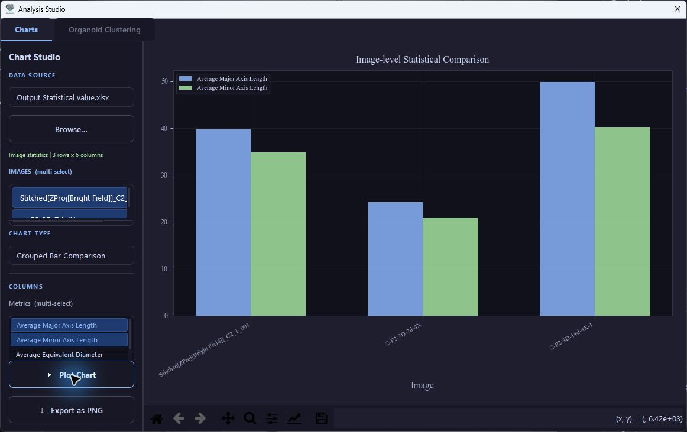

### 4.2 折线对比

选择 **Line Comparison**，展示所选指标在图片之间的变化。

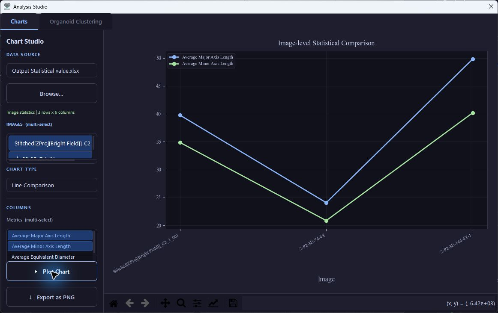

若图片不是按时间或剂量采集的有序样本，连线只是视觉比较，不代表时间趋势。本模块将多张图片放在同一图中比较；不要把每图平均值的简单平均当成所有对象合并后的平均值。

## 5. 单图与多图联合聚类

进入 **Organoid Clustering**。聚类对象是分割出来的个体类器官，不是把整张显微图片归类。

### 5.1 单张图片内部的形态聚类

选择 **Morphology Parameters**，在图片范围中选一张图，选择形态特征和类别数，点击 **Run Automatic**。

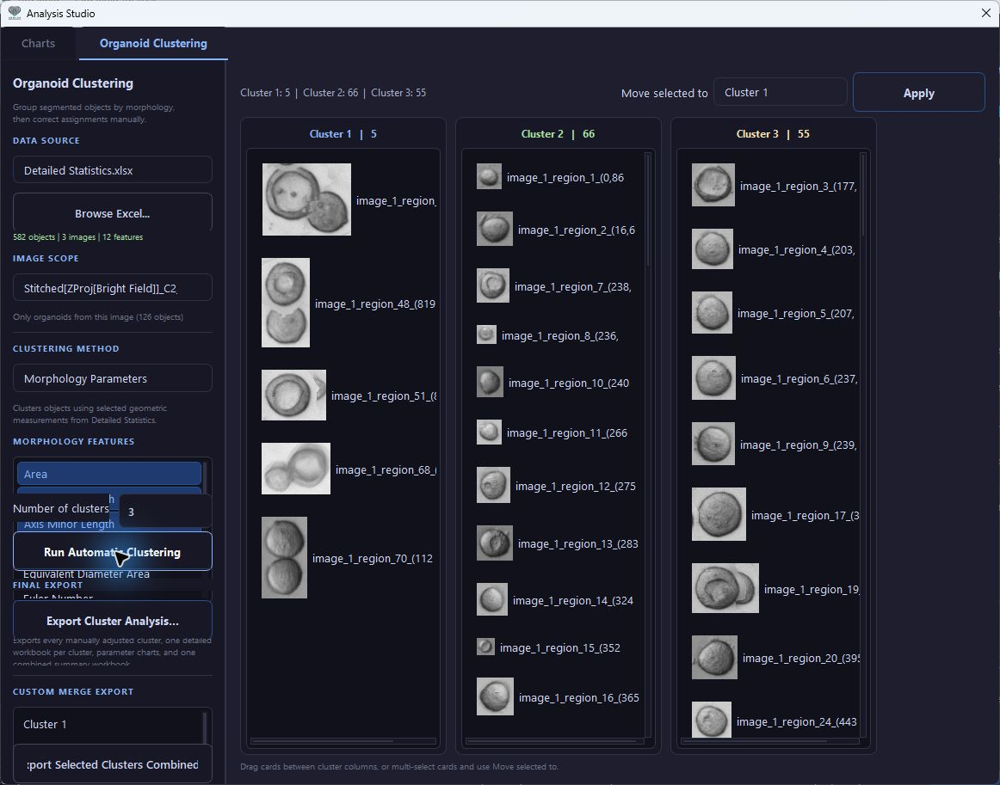

本次第一张图的 126 个对象，K = 3，得到 **5、66、55** 个对象，用于展示同一图片内部的分组。

### 5.2 多张图片联合形态聚类

图片范围选择 **All images (combined clustering)**，设置特征与类别数后重新运行。

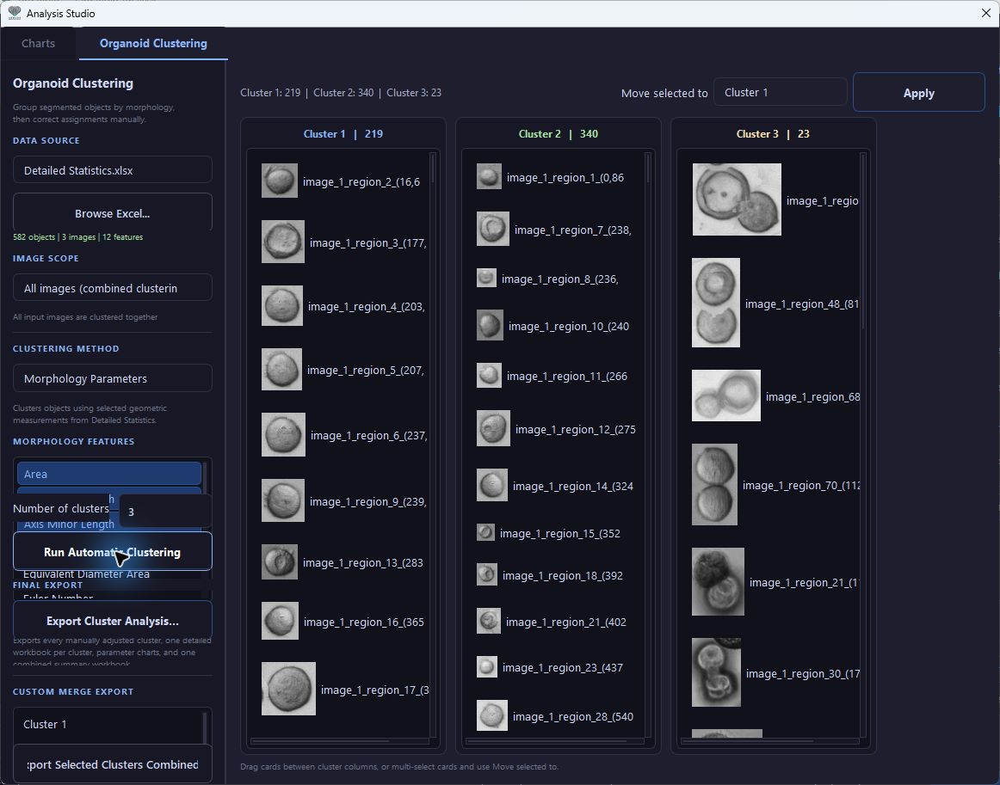

本次 582 个对象联合聚为 3 类，数量为 **219、340、23**。联合聚类在一次运行中建立共享分组；分别运行的单图 Cluster 1 不保证具有相同含义。

### 5.3 图像特征聚类

方法选择 **EfficientNetB3 Image Features**，使用对象图像提取特征后聚类。

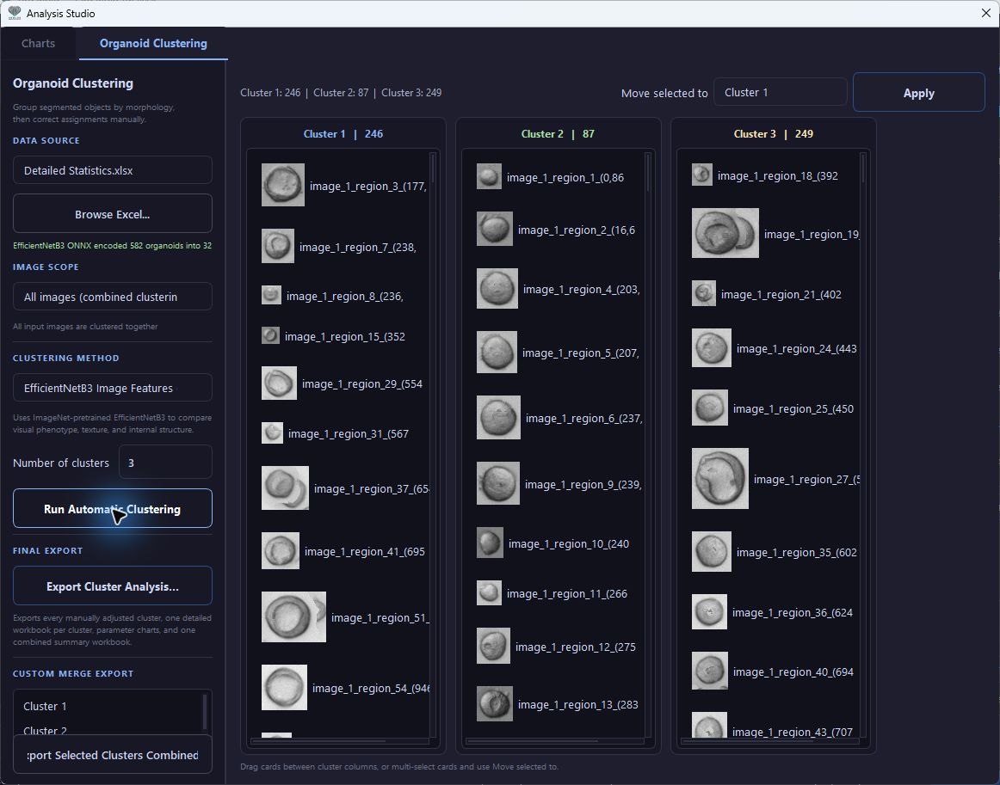

本次 K = 3，得到 **246、87、249** 个对象。图像特征与形态参数包含的信息不同，因此分组可能不同。类别编号没有预设生物学含义，不等于已识别某种细胞类型或成熟阶段。

## 6. 手动调整与聚类导出

### 6.1 人工调整对象归属

选择对象卡片，通过 **Move selected to** 选择目标类别，点击 **Apply**。调整前建议保存原始分组，并记录调整理由。

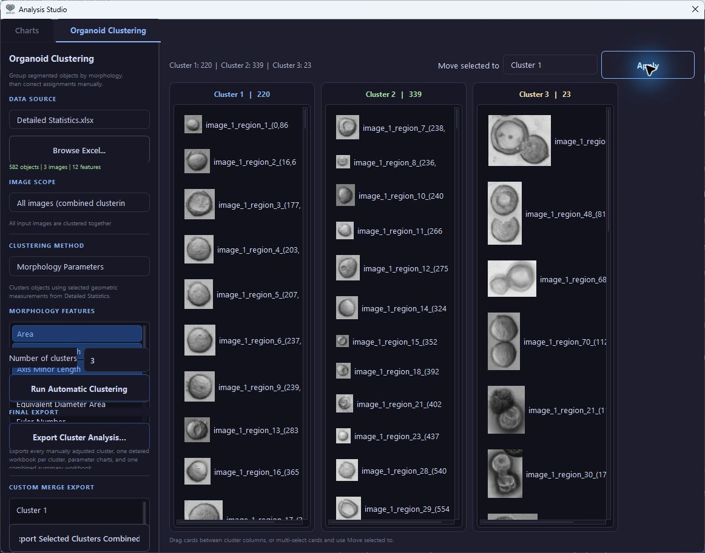

本次仅为操作演示移动了一个对象，类别数量由 219/340/23 变为 **220/339/23**，不代表经过生物学审核的标签修正。

### 6.2 导出类别明细、参数图与汇总

点击 **Export Cluster Analysis…** 并选择目录，导出当前调整后的类别分析。

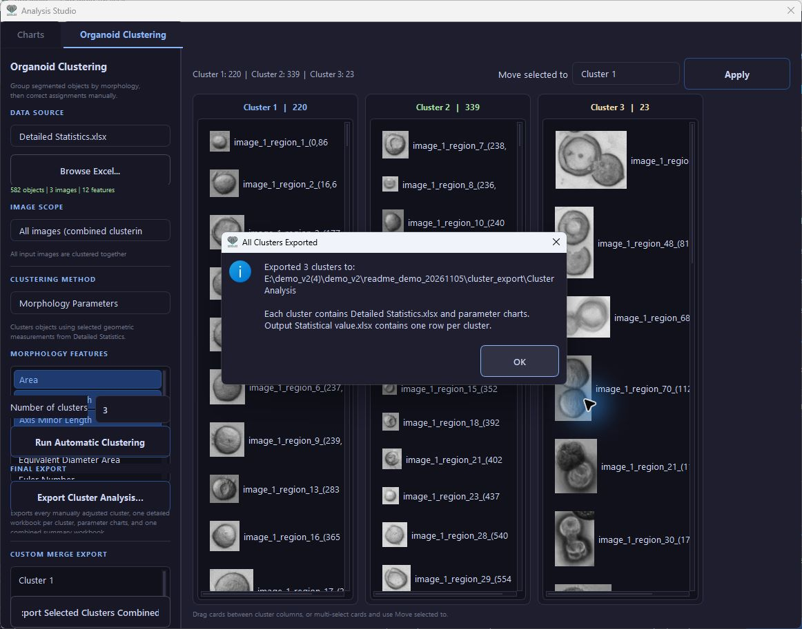

```text
Cluster Analysis/
├─ Output Statistical value.xlsx
├─ Cluster_1/
│  ├─ Detailed Statistics.xlsx
│  └─ Histograms/
├─ Cluster_2/
│  ├─ Detailed Statistics.xlsx
│  └─ Histograms/
└─ Cluster_3/
   ├─ Detailed Statistics.xlsx
   └─ Histograms/
```

界面另有 **Export Selected Clusters Combined…**，用于指定类别的组合导出，本次未单独执行。已实测导出的文件来自人工调整后的形态聚类，不是之后重新运行的图像特征聚类。

## 7. 比例尺与区域分析

### 7.1 比例尺标定

菜单 **Preprocessing Components → Scale Calibration (µm/pix)…**，快捷键 **Ctrl + Shift + M**。进入后按提示框住比例尺。

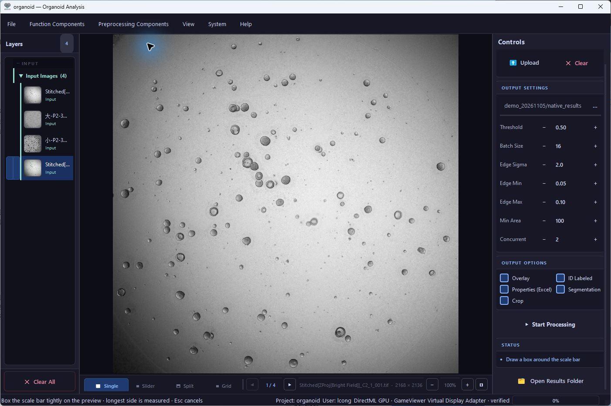

本次没有可靠的实际比例尺数值，因此只展示入口并取消，未填写假定尺寸。应依据显微镜标定或已知比例尺设置；未确认标定前，不要把像素长度和面积直接写成 µm 和 µm²。

### 7.2 指定分析区域

菜单 **Preprocessing Components → Screenshot / Region Analysis…**，快捷键 **Ctrl + Shift + P**，在预览图上拖出矩形。

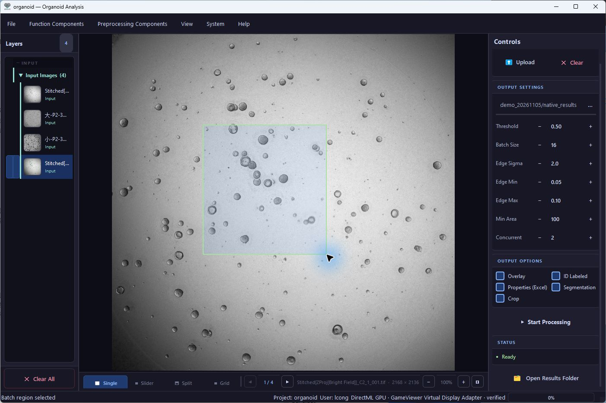

本次实际完成框选，未用该区域重新运行分割；随后使用 **Clear Analysis Region · Use Full Images** 恢复全图。批量处理不同尺寸图片时，应先核对区域映射。

## 常见问题与使用边界

**找不到结果？** 本次所选输出目录已存在，程序实际写入追加 `_1` 的目录，但完成提示仍显示原目录。请找到包含两个 Excel 的 `Analysis_result`，必要时在 Charts 中手动指定。

**图表中文显示方框？** 当前运行包部分图表标签缺少中文字体，数据仍可读取。可以使用英文样本编号并保留名称对照表，或由维护者修复字体后重新出图。

**聚类控件拥挤？** 本次窗口尺寸下存在局部布局拥挤；发布前建议检查不同分辨率与显示缩放。

**对比/网格视图未切换？** 本次未成功验证 Slider/Grid 切换及完整原图—结果配对，不作为已通过功能宣传。可先使用单图和导出结果复核。

**能直接用于统计结论吗？** 聚类是探索性分组，需结合人工复核。582 个对象不自动等于 582 个独立生物学重复；推断时应考虑培养孔、图片与实验批次层级。

**适用于所有图像吗？** 本次只验证随软件提供的 3 张图，其他成像条件、倍率和样本需重新评估。软件输出不应直接替代临床判断。

## 反馈与平台信息

反馈时请提供版本、步骤、报错截图及可公开的最小示例，先移除隐私和账户信息。正式下载链接、平台官网、联系方式与许可证声明应由发布者确认后添加，本文未虚构这些信息。

演示日期：2026-11-05。详见 [演示记录与待验证项](docs/DEMO_RUN.md)。
